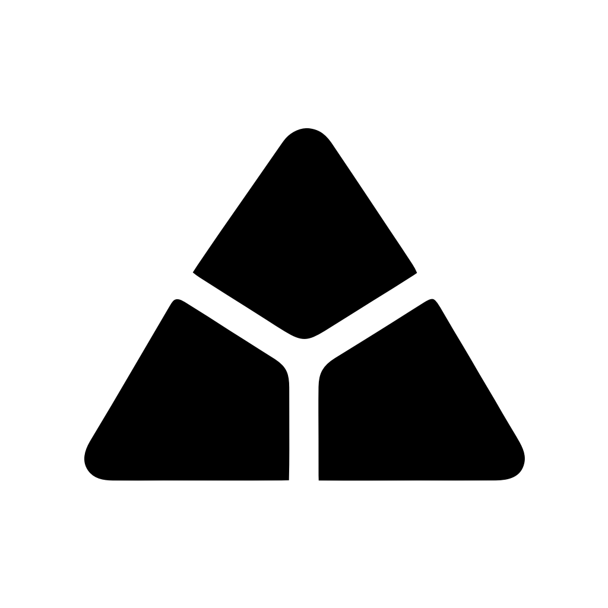
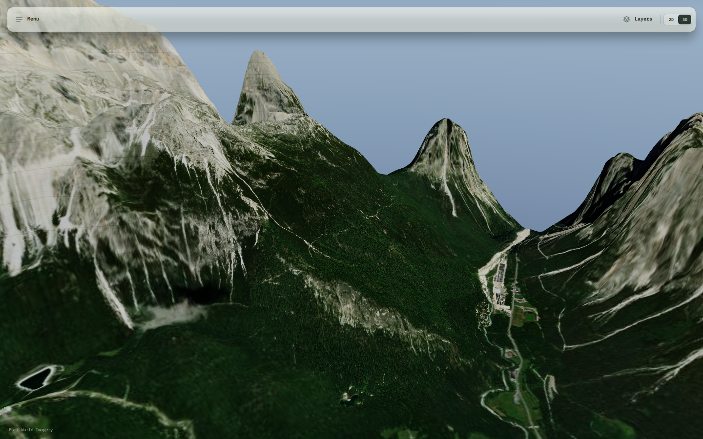
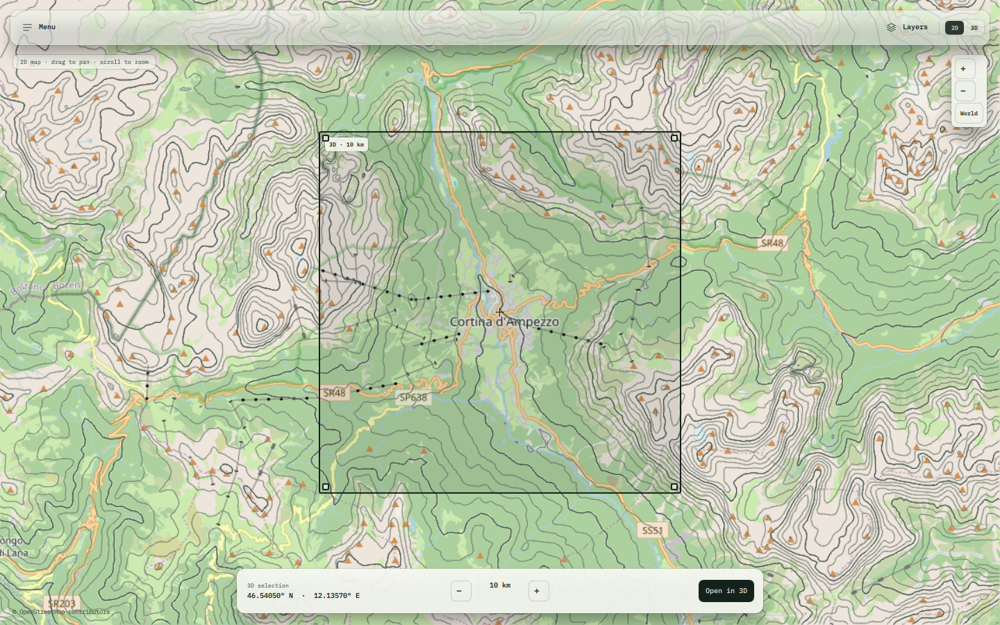
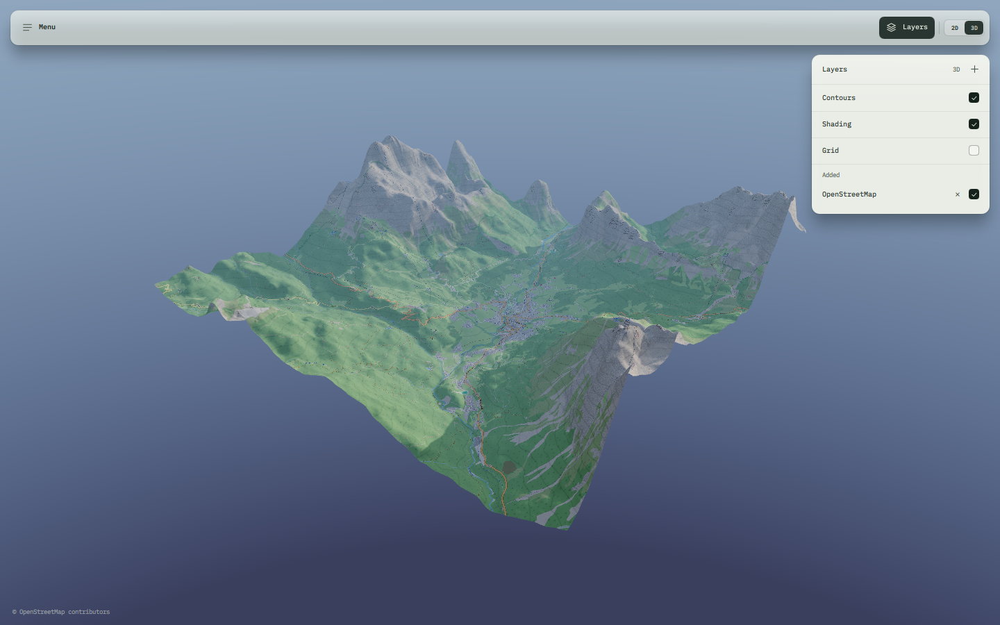
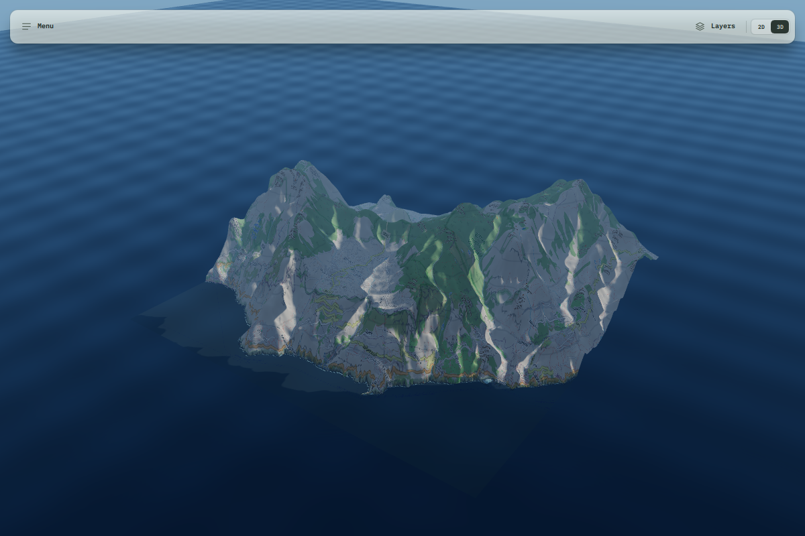

<p align="center">
  
</p>

<h1 align="center">Montara</h1>

<p align="center">
  <strong>Real-time 3D terrain viewer for Windows.</strong><br>
  Pick a place on the map. Read the land in three dimensions.
</p>

<p align="center">
  <a href="../../releases/latest"></a>
  
  
  
</p>



<p align="center"><sub>Cortina d'Ampezzo, Dolomites — real Terrarium elevation and Esri World Imagery.</sub></p>

## What Montara is

Montara is a desktop terrain viewer built around one move: choose an area on
a real 2D map and open it as a 3D landscape. The same map layers are draped
over real elevation, contours are drawn in metres, and the camera can drop to
the ground in fly mode.

It is not a globe, and it is not a game. It is a focused tool for seeing a
place before you go there — or for understanding the shape of the land from
your desk.

Every screenshot on this page is from the app, not a mock-up.

## Highlights

- **2D → 3D without an import step.** Draw the 10 km square on the map and
  open it in 3D. A 50 km context ring streams around the selection, so the
  horizon does not stop at the square.
- **Real elevation.** Terrarium DEM at a true 1:1 vertical scale. Contours,
  hillshade, sun and shadows are computed from the terrain, not painted on.
- **One layer stack for both views.** OpenStreetMap, Esri World Imagery and
  custom XYZ sources; up to eight layers; OSM roads rebuilt as
  terrain-following ribbons in 3D.
- **A landscape you can fly through.** First-person fly mode with a
  terrain-following eye height. The sharp detail patch follows the camera as
  it moves.
- **Designed for reading the land.** Fine, index and major contours in metres;
  elevation fill; grid; sea-level water; time-of-day lighting.
- **Files in and out.** Import a heightmap (PNG/JPG/WebP), export a 193 × 193
  grayscale heightmap or a Wavefront OBJ, and save a clean PNG snapshot
  without UI chrome.

## From map to mountain



The 2D map is a full-screen slippy map. Drag the square or its corner handles,
then press **Open in 3D**. Coordinate search accepts WGS 84 or EPSG:3857.

## Layers that follow the terrain



The layer stack is shared by the 2D map and the 3D drape: raster tiles are
composited bottom-to-top on the terrain, with per-layer visibility and a
2 GB disk cache. Satellite imagery uses a softer shading mix and a shadow
lift, because the imagery already contains baked-in lighting; map layers keep
the full terrain shading.

## Light, water and shadow



A procedural sky and time-of-day presets drive the native sun and shadow map.
Sea-level water uses Fresnel reflection for coastal areas, while the terrain
keeps its full 1:1 relief. The 3D scene is rendered in HDR and tone-mapped
with ACES.

## Download

**[Download the latest Windows build →](../../releases/latest)**

1. Download `Montara-0.1.2-public.zip`.
2. Extract the archive.
3. Run `Montara-0.1.2-Setup.exe` and follow the installer.

The installer is not code-signed yet, so Windows SmartScreen may ask for
confirmation. The archive includes `SHA256SUMS.txt` if you want to verify the
download.

### Winget

Winget manifests are prepared for submission. Once the package is accepted:

```powershell
winget install --id Montara.Montara -e
```

### Requirements

| | |
|---|---|
| OS | Windows 10 or 11, 64-bit |
| Graphics | Vulkan-capable GPU recommended; a CPU rasterizer is included as a fallback |
| Disk | About 400 MB after installation |
| Network | Required for new areas; decoded tiles are cached locally |

## Controls

| | |
|---|---|
| 2D map | Drag to pan, scroll or pinch to zoom; drag the square or its handles to change the 3D area |
| 3D view | Drag to orbit, right/middle-drag to pan, scroll or pinch to zoom |
| Fly mode | `V`; drag to look, arrow keys to move, `PgUp`/`PgDn` to change altitude |
| Coordinate search | `Ctrl+F` — WGS 84 latitude/longitude or EPSG:3857 X/Y |
| Reset / fullscreen / snapshot | `R` / `F` / `S` |

## Under the hood

Montara is a Qt 6/QML application with a native Rust renderer loaded into the
Qt process. The Vulkan path renders terrain, the raster drape, procedural sky,
shadows and water into an HDR buffer and tone-maps with ACES; a Rust CPU
rasterizer is included as a fallback. Map tiles and Terrarium elevation are
streamed and cached locally.

The 3D scene uses a nested terrain window: a 50 km context ring, a 20 km sharp
core and a close detail patch around the selected area. The **Terrain detail**
preset in Settings → Graphics controls how deep each layer goes:

| Preset | Context | 20 km core | Detail patch | Fly close patch |
|---|---|---|---|---|
| Fast | z12 | z13 | z14 | z14 |
| Balanced | z13 | z14 | z17 | z18 |
| High | z14 | z16 | z18 | z18 |

In fly mode the 2 km close patch follows the camera, and missing z18 tiles fall
back to z17 instead of leaving holes. Fast is the recommended preset for a
slow connection; Balanced is the default.

## What's new in 0.1.2

- **Manual terrain detail:** Settings → Graphics now has Fast, Balanced and
  High presets. Fast keeps the first 3D view usable on a ~0.5 Mbit/s link;
  Balanced is the default; High raises the 20 km core to z16 and the centre
  and close patch to z18 where the provider has it. The preset is saved and
  can be changed without moving the camera.
- The 2D map requests a deeper tile zoom and downscales instead of stretching
  tiles; it is high-DPI aware and the DEM contour overlay is generated at the
  full viewport resolution.
- The 3D core and detail meshes are now `1024 × 1024`; small selections fit the
  camera instead of being viewed from far away, and the orbit camera can move
  closer without clipping into the terrain.
- In Balanced and High, the fly-mode close patch follows the camera at z18;
  High also uses z18 for the 5.8 km centre. Missing z18 tiles fall back to z17
  instead of leaving holes (the same max native zoom as the Esri layer on
  Nakarte). OSM stays at z17 for its public tile policy.
- Large fly areas use the camera-following close patch; orbit stays at a safe
  framing distance so the edge of the finite 50 km world is not exposed.
- The app opens on the 2D world map and no longer restores the previous camera
  position at launch.

## Status

`0.1.2` is the current public Windows build. It is deliberately focused:

- WMS/WMTS and place-name search are not in this release.
- Google Maps imagery is optional and needs your own Map Tiles API key.
- Fly mode, water, shadows and TAA are Vulkan-only; the CPU fallback omits them.
- The public OSM tile service is rate-limited. For heavy 3D use, choose Esri
  World Imagery.
- High detail is bandwidth-hungry: the first 5.8 km z18 load is thousands of
  tiles. On a slow link choose Fast; Balanced and High are multi-minute first
  loads at 0.5 Mbit/s.

## Feedback

Bug reports and feature requests are welcome in
[Issues](../../issues). Please include the app version and, if possible, the
log file from **Menu → Files → Open logs**.

## License

Montara is proprietary software. The [LICENSE](LICENSE) grants a limited right
to install and use the application for personal or internal business purposes.
It does not permit redistribution, modification or reverse engineering, except
for the rights the LGPLv3 grants over the Qt/PySide6 components.

Qt 6 and PySide6 are used under the LGPLv3 and shipped as separate, replaceable
DLLs. The GPLv3 text in `LICENSES/` covers Qt, not the Montara application.
See [THIRD-PARTY-NOTICES.txt](THIRD-PARTY-NOTICES.txt) for the full component
and data attributions.

Montara's application source is proprietary and is not open source.

## Credits

- Elevation: [Terrarium terrain tiles](https://registry.opendata.aws/terrain-tiles/)
  (Mapzen / AWS Open Data).
- Maps: © OpenStreetMap contributors (ODbL), Esri World Imagery, optional
  Google Maps.
- Type: IBM Plex Mono (SIL Open Font License).
- Built with Qt 6 / PySide6 (LGPLv3), Rust, Vulkan and Python.
