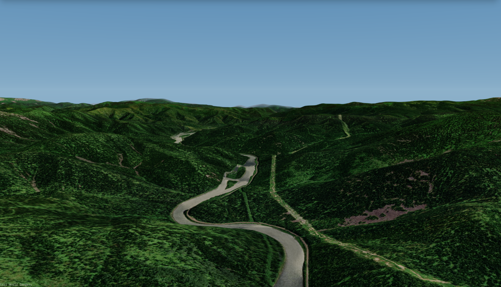
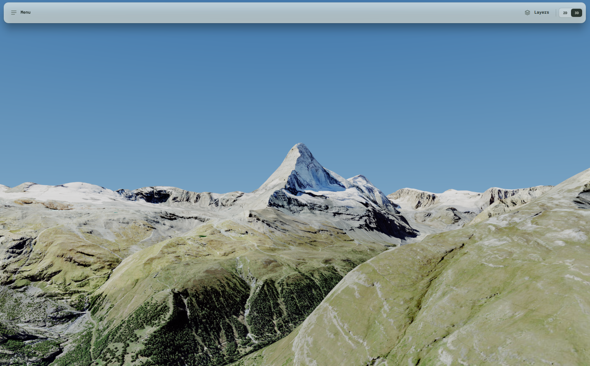
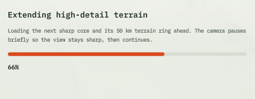
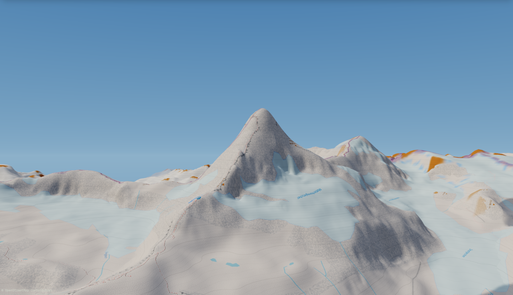

# Montara

**Real-time 3D terrain viewer for Windows**

## Table of Contents

* [About](#-about)
* [Preview](#-preview)
* [Loading Terrain Data](#-loading-terrain-data)
* [OpenStreetMap 3D](#-openstreetmap-3d)
* [Quickstart](#-quickstart)
* [Notices](#-notices)

## 🚀 About

**Montara** is a fast, native **real-time 3D terrain viewer for Windows** designed for exploring digital elevation models, mountain peaks, and topographic data with smooth camera navigation.

## 📸 Preview

**Taking care of every pixel** — engineered for sharp relief rendering, accurate elevation geometry, and clean shading across complex mountain landscapes.

## 📂 Loading Terrain Data

Quickly load and inspect elevation datasets with a clean, streamlined workflow:

## 🌍 OpenStreetMap 3D

**Ability to use OpenStreetMap for 3D right now** — combine topographic heightmaps with OpenStreetMap data for instant 3D spatial context:

## ⚡ Quickstart

1.Download fast installer in releases
2.Enjoy app

## 📄 Notices

Third-party libraries and license attributions can be found in [`THIRD-PARTY-NOTICES.txt`](THIRD-PARTY-NOTICES.txt).
